<!--
  Recon complete: you read the source. Good instinct.
  No flag in here, though. Those live where they belong: https://idanlab.dev
-->

<a href="https://idanlab.dev">
  <picture>
    <source media="(prefers-color-scheme: dark)" srcset="assets/hero-dark.svg">
    <source media="(prefers-color-scheme: light)" srcset="assets/hero-light.svg">
    
  </picture>
</a>

I'm **Idan Babayan**, a cybersecurity student and CTF player who fell hard for offensive security and never looked back. I break things on purpose, in places built to be broken, and write down how they fell at **[idanlab.dev](https://idanlab.dev)**.

  <a href="https://idanlab.dev"><picture><source media="(prefers-color-scheme: dark)" srcset="assets/btn-site-dark.svg"><source media="(prefers-color-scheme: light)" srcset="assets/btn-site-light.svg"></picture></a>&nbsp;
  <a href="https://www.linkedin.com/in/idanbabayan"><picture><source media="(prefers-color-scheme: dark)" srcset="assets/btn-linkedin-dark.svg"><source media="(prefers-color-scheme: light)" srcset="assets/btn-linkedin-light.svg"></picture></a>&nbsp;
  <a href="mailto:contact@idanlab.dev"><picture><source media="(prefers-color-scheme: dark)" srcset="assets/btn-email-dark.svg"><source media="(prefers-color-scheme: light)" srcset="assets/btn-email-light.svg"></picture></a>

## whoami

<picture>
  <source media="(prefers-color-scheme: dark)" srcset="assets/whoami-dark.svg">
  <source media="(prefers-color-scheme: light)" srcset="assets/whoami-light.svg">
  
</picture>

> I don't just want to know *what* the exploit is. I want to know *why* it works, what the defender missed, and how I'd catch it next time.

## the loop

<picture>
  <source media="(prefers-color-scheme: dark)" srcset="assets/loop-dark.svg">
  <source media="(prefers-color-scheme: light)" srcset="assets/loop-light.svg">
  
</picture>

Every box gets the same loop, and the dead ends stay in the notes. If a so-called easy one humbled me, I say so. That's how you actually get better.

## things I build

<!-- projects:start -->

<a href="https://github.com/Idan-Babayan/IdanLab"><picture><source media="(prefers-color-scheme: dark)" srcset="assets/project-idanlab-dark.svg"><source media="(prefers-color-scheme: light)" srcset="assets/project-idanlab-light.svg"></picture></a>
<a href="https://github.com/Idan-Babayan/MobileCApp"><picture><source media="(prefers-color-scheme: dark)" srcset="assets/project-mobilecapp-dark.svg"><source media="(prefers-color-scheme: light)" srcset="assets/project-mobilecapp-light.svg"></picture></a>

<!-- projects:end -->

## where I'm headed

> [!TIP]
> **Hiring for pentesting or red teaming?** I'm sharpening my skills toward my first role in security. I learn fast, I document everything, and I genuinely love this work. Say hi at [contact@idanlab.dev](mailto:contact@idanlab.dev) or on [LinkedIn](https://www.linkedin.com/in/idanbabayan).

<picture>
  <source media="(prefers-color-scheme: dark)" srcset="assets/footer-dark.svg">
  <source media="(prefers-color-scheme: light)" srcset="assets/footer-light.svg">
  
</picture>
